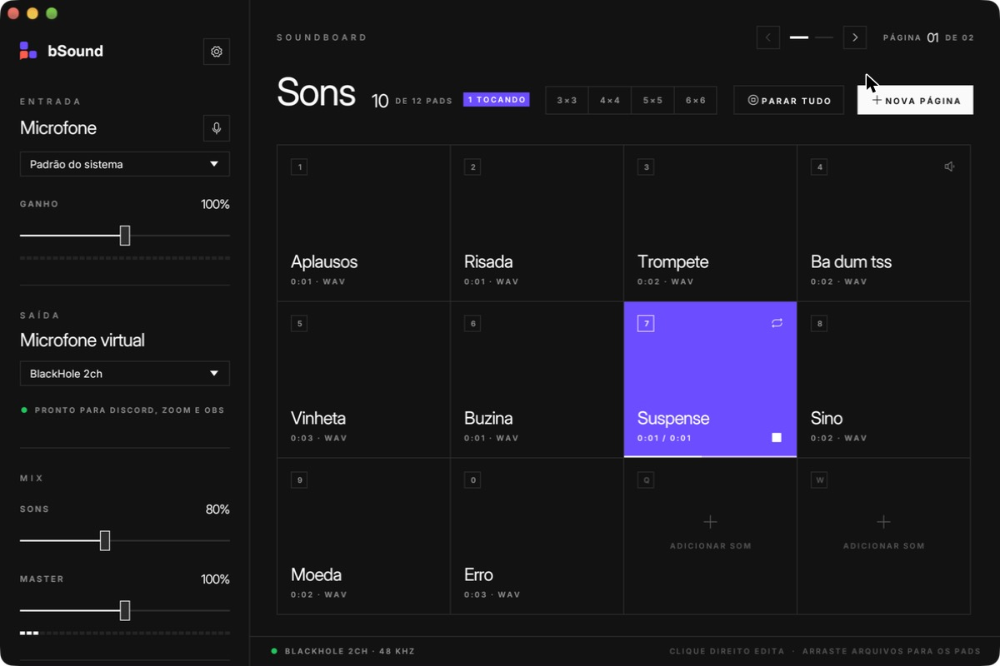
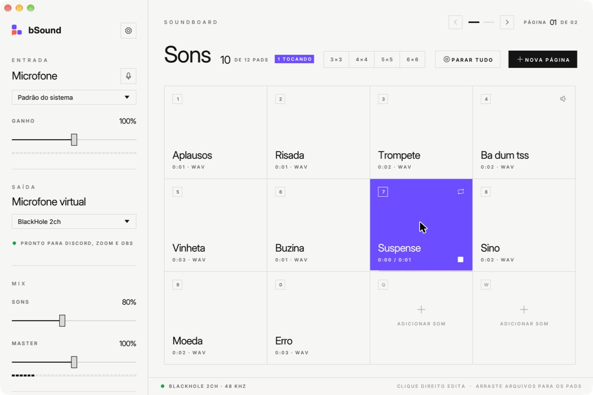
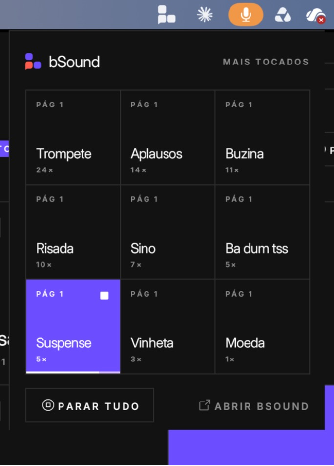
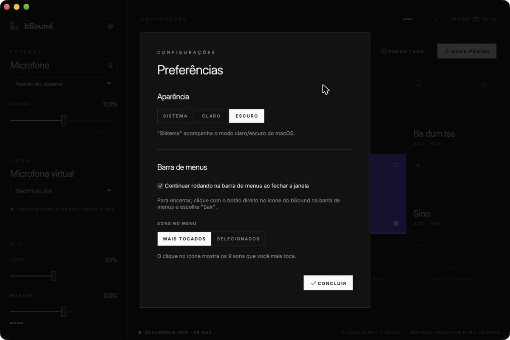

<p align="center">
  <picture>
    <source media="(prefers-color-scheme: dark)" srcset="docs/logo-dark.svg">
    
  </picture>
</p>

<p align="center">
  <strong>Sua voz e seus sons, juntos em qualquer app.</strong><br>
  Soundboard para macOS, escrito em Rust: mistura o microfone com os seus sons e envia tudo para um microfone virtual (BlackHole) que Discord, Zoom, OBS e outros apps enxergam como entrada.
</p>

<p align="center">
  
</p>

## Recursos

- **Mic + soundboard no mesmo canal.** O áudio do microfone e dos pads é mixado em tempo real, com limitador suave, e enviado para o BlackHole 2ch.
- **Pads com arrastar e soltar.** Clique num quadrado vazio ou arraste arquivos do Finder (MP3, WAV, OGG, FLAC, M4A/AAC, AIFF, CAF).
- **Páginas de pads.** Crie quantas páginas precisar (até 16), navegue pelas setas ou pelas teclas ← →, e acompanhe a página atual no indicador do topo.
- **Edição por pad.** Pelo botão direito do mouse: nome, volume, loop, "clique reinicia", tecla de atalho e "mostrar na barra de menus".
- **Atalhos de teclado.** Cada pad da página aberta tem uma tecla (1–0, Q, W, E…), e você pode trocar.
- **Monitor.** Ouça os sons (e, se quiser, o próprio mic) nos fones, separado da saída virtual.
- **Barra de menus.** O ícone abre um popover com os sons mais tocados ou selecionados, em pads. Fechar a janela mantém o app rodando lá.
- **Modo claro e escuro.** Pode acompanhar o macOS ou ficar fixo, nas Configurações.
- **Assistente do BlackHole.** Se o driver não estiver instalado, o app guia a instalação via Homebrew ou pelo instalador oficial.

## Telas

| Modo claro | Modo escuro |
|---|---|
|  |  |

| Popover da barra de menus | Configurações |
|---|---|
|  |  |

## Requisitos

- macOS 11 ou mais recente.
- [BlackHole 2ch](https://existential.audio/blackhole/), o microfone virtual (o app ajuda a instalar).
- Rust estável, para compilar.

## Compilar e rodar

Neste projeto, a toolchain do Rust e os caches de build ficam no SSD externo:

```bash
export RUSTUP_HOME=/Volumes/ExternalSSD/rust/rustup
export CARGO_HOME=/Volumes/ExternalSSD/rust/cargo
export PATH="$CARGO_HOME/bin:$PATH"
```

O `.cargo/config.toml` manda os artefatos para `/Volumes/ExternalSSD/rust/target/soundboard`. Para rodar em modo de desenvolvimento:

```bash
cargo run
```

Para gerar o app (`dist/bSound.app`, com ícone e permissão de microfone próprios):

```bash
./scripts/bundle.sh
```

Para rodar os testes do mixer, do resampler e do decodificador:

```bash
cargo test
```

## Como usar

1. Abra o bSound. Se o BlackHole não estiver instalado, siga o assistente.
2. Em **Saída**, deixe **BlackHole 2ch** selecionado.
3. No Discord, Zoom, OBS etc., escolha **BlackHole 2ch** como microfone.
4. Adicione sons nos pads e toque clicando ou pelas teclas de atalho.
5. Para ouvir os sons você mesmo, escolha seus fones em **Monitor**.

Para encerrar o app quando ele estiver só na barra de menus, clique com o botão direito no ícone e escolha **Sair do bSound**.

## Estrutura

```
src/
  main.rs            janela e inicialização
  app.rs             estado, barra lateral, barra de status, atalhos
  audio/             motor de áudio (cpal), mixer, decodificação e reamostragem
  ui/board.rs        páginas e grade de pads
  ui/popover.rs      popover da barra de menus
  ui/settings.rs     configurações
  ui/wizard.rs       assistente do BlackHole
  ui/theme.rs        tema claro/escuro e componentes
  tray.rs            ícone da barra de menus
  stats.rs           contagem de sons mais tocados
docs/                logo e capturas de tela do README
```

Configurações e contagens ficam em `~/Library/Application Support/soundboard/`.

## Marca

O símbolo são três pads do soundboard, e o de baixo à esquerda é um balão de fala: sua voz no meio dos sons. Os três juntos desenham um **b**. Cores: Pad Violet `#6C4DFF`, Voice Coral `#FF5C4D` e Ink `#16141F`.

## Créditos

- Fonte [Inter](https://github.com/rsms/inter), licença SIL OFL 1.1 (`assets/fonts/OFL.txt`).
- Ícones [Phosphor](https://phosphoricons.com/), via `egui-phosphor`.
- Interface com [egui/eframe](https://github.com/emilk/egui), áudio com [cpal](https://github.com/RustAudio/cpal) e [Symphonia](https://github.com/pdeljanov/Symphonia).
